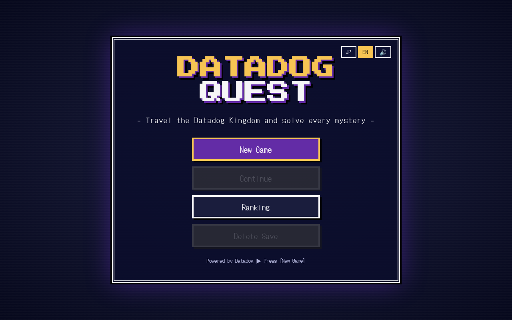
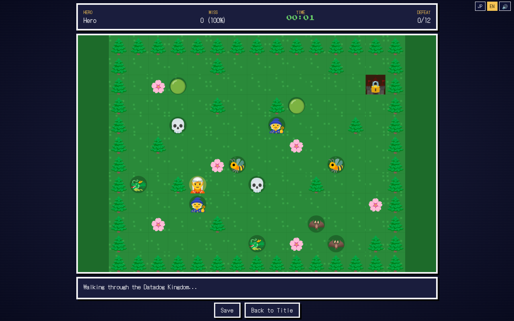
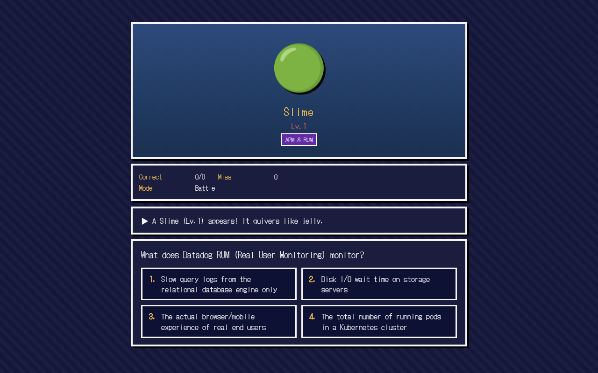

# Datadog Quest

> 🇬🇧 English (this page) | 🇯🇵 [日本語](./README.ja.md)

A NES-style retro RPG that quizzes you on Datadog skills (APM/RUM, Infrastructure, Security, Agent Observability, CI/CD, SLO, Integration). Runs in your browser on Node.js + Express. UI and questions support **both Japanese and English** with an in-game toggle.


## 📸 Screenshots

| Title | Field | Battle |
|:---:|:---:|:---:|
|  |  |  |

> The ending is not shown here to avoid spoilers — rescue Bits and see it for yourself!

## 🎮 Story

The Datadog Kingdom was protected by a small fairy called **Bits**, who lit the realm with the light of metrics and traces. One day an impostor calling itself **DARK BITS** seized the king's castle, imprisoned the true Bits deep inside, and plunged the kingdom into darkness.

You — a hero summoned to restore observability — must travel the kingdom, defeat 12 trials, beat DARK BITS in a 5-question boss battle, and **rescue the captive Bits**.

### Question Categories

| Category | Description |
| -- | -- |
| APM & RUM | Distributed tracing, Spans, RUM Core Web Vitals, etc. |
| Infrastructure | Agent, Kubernetes, Autodiscovery, Cluster Agent, etc. |
| Security | Cloud SIEM, ASM, CSM, CWS, SDS, etc. |
| Agent Observability | LLM Observability, Quality Evaluations, RAG instrumentation, etc. |
| CI/CD | CI Visibility, Test Optimization, ITR, Deployment Tracking, etc. |
| SLO | SLI/SLO/Error Budget, Burn Rate, Multi-window, etc. |
| Integration & Instrumentation | OTel, AWS, Lambda, Admission Controller, SSI, etc. |

### Enemies (level shown by color)

- Slime / Mage / Skeleton / Bat / Bee / Dragon
- Boss: 🐕 **DARK BITS** (the impostor that calls itself Bits)

### Features

- Tile-based movement (arrow keys / WASD, on-screen D-pad, or swipe)
- 12 enemies placed randomly on the map each new game
- Choice order is shuffled so the correct answer is never always at position 1
- Player name entry → typewriter-style intro → adventure begins
- HUD shows name, mistakes/accuracy, play time, defeats
- Saves to both `localStorage` and server-side JSON (same player ID resumes)
- Score = `(accuracy × 10000) − elapsed seconds`
- Rankings (top 20) available from the title screen and end-of-game
- **Bilingual UI and questions** with an in-game language toggle (JP / EN)
- Wrong answers don't end the game — keep playing and your score absorbs the penalty
- **Responsive layout**: the field screen fills the browser and follows window resizing
- **Mobile friendly**: touch controls (on-screen D-pad + swipe) appear automatically on touch devices / small screens
- **Crisp at any size**: the field canvas renders at the display resolution (device pixel ratio aware), so characters and enemies stay sharp even when scaled up
- **No-save buttons are greyed out** ("Continue" / "Delete save") until a save exists

## 🚀 Run Locally

### Requirements

- Node.js 18 or later
- npm

### Steps

```bash
npm install
npm start
```

Open `http://localhost:3000` in your browser.

To change the port:

```bash
PORT=8080 npm start
```

## 🎯 Controls

| Input | Action |
| -- | -- |
| ↑↓←→ / WASD | Move the hero |
| On-screen D-pad (▲◀▶▼) | Move the hero (touch devices / narrow screens) |
| Swipe on the field | Move the hero one tile in the swipe direction |
| Click / Tap | Pick an answer / press a button |
| Enter | Confirm name dialog |
| JP / EN buttons | Switch language (title screen + HUD) |

> The on-screen D-pad shows up automatically on touch devices and when the viewport is narrow (≤ 820px). On a desktop you can preview it with your browser's device toolbar.

## 🐳 Docker

```bash
docker build -t datadog-quest .
docker run -p 3000:3000 -v $(pwd)/data:/app/data datadog-quest
```

Or with Docker Compose:

```bash
docker compose up --build
```

> Mounting `data/` keeps saves and rankings across container restarts.

## ☁️ Cloud Deployment

### Persistence note

Saves and rankings are stored in the filesystem under `data/`. On platforms with ephemeral disks (Cloud Run, Lambda, ECS Fargate without EFS, etc.) data is lost when instances restart. For production, do one of:

- Mount a persistent volume (EFS / Persistent Disk / Azure Files / Render Disk, etc.)
- Migrate to an external store (Redis, Postgres, Datadog KV, etc.)

### Cloud Run example

```bash
# build & push
gcloud builds submit --tag gcr.io/$PROJECT_ID/datadog-quest

# deploy (demo only - no persistence)
gcloud run deploy datadog-quest \
  --image gcr.io/$PROJECT_ID/datadog-quest \
  --region us-central1 \
  --allow-unauthenticated
```

Use **GCS FUSE** or **Cloud Run Volumes** for persistence.

### AWS ECS Fargate

1. Push the image to ECR
2. Mount `data/` to EFS in the ECS Task Definition
3. Expose via ALB or a public IP

### Azure Container Apps

```bash
RG=datadog-quest-rg
LOCATION=japaneast
ACR=datadogquest$RANDOM   # must be globally unique
ENV_NAME=datadog-quest-env

# first time per subscription: register the required resource providers
az provider register -n Microsoft.App --wait
az provider register -n Microsoft.OperationalInsights --wait
az provider register -n Microsoft.ContainerRegistry --wait

# resource group & container registry
az group create -n $RG -l $LOCATION
az acr create -g $RG -n $ACR --sku Basic

# build & push (built in the cloud by ACR Tasks - no local Docker required)
az acr build -r $ACR -t datadog-quest:latest .

# Container Apps environment
az containerapp env create -g $RG -n $ENV_NAME -l $LOCATION

# deploy (demo only - no persistence)
az containerapp create -g $RG -n datadog-quest \
  --environment $ENV_NAME \
  --image $ACR.azurecr.io/datadog-quest:latest \
  --registry-server $ACR.azurecr.io \
  --registry-identity system \
  --target-port 3000 \
  --ingress external \
  --min-replicas 1 --max-replicas 1 \
  --secrets admin-password=<your-strong-password> \
  --env-vars ADMIN_USERNAME=admin ADMIN_PASSWORD=secretref:admin-password

# print the public URL
az containerapp show -g $RG -n datadog-quest \
  --query properties.configuration.ingress.fqdn -o tsv
```

- `--max-replicas 1` keeps saves/rankings consistent, since they live on the local filesystem of each replica.
- The admin password is stored as a Container Apps secret and referenced via `secretref:`.
- Right after creation, the URL may take a few minutes to start responding.

For persistence, mount an **Azure Files** share:

1. Create a Storage Account and a file share, then upload `data/questions.json` and `data/questions.en.json` to it (the mount replaces the image's `data/` directory)
2. Register it with the environment: `az containerapp env storage set --access-mode ReadWrite --azure-file-account-name ... --azure-file-account-key ... --azure-file-share-name ...`
3. Add a volume (`storageType: AzureFile`) and a `volumeMounts` entry at `/app/data` to the app's YAML, then apply it with `az containerapp update --yaml`

### Render / Railway / Fly.io

These platforms auto-detect the `Dockerfile`. Enable a Persistent Disk and mount `data/`.

## 🛠 Admin UI

A built-in admin screen at `/admin` lets you manage the question bank (CRUD) without editing JSON files by hand. Both Japanese and English fields are edited side-by-side.

### Enabling

Set `ADMIN_PASSWORD` (and optionally `ADMIN_USERNAME`, default `admin`) before launching:

```bash
ADMIN_PASSWORD=your-strong-password npm start
# or
ADMIN_USERNAME=admin ADMIN_PASSWORD=your-strong-password node server.js
```

Open http://localhost:3000/admin and authenticate via Basic Auth.

If `ADMIN_PASSWORD` is unset, the admin endpoints return `503 Admin disabled`.

### Features

- List, search and filter all questions by category / level
- Create, edit, delete questions (writes back to `data/questions.json` and `data/questions.en.json` atomically)
- English fields are optional per question
- **Reset the leaderboard** — the "🏆 Reset ranking" button clears all ranking entries (`data/ranking.json`) after a confirmation dialog

### Security note

Basic Auth over plain HTTP is only suitable for trusted networks (localhost, internal VPN, dev/PoC). For public deployments put a TLS-terminating reverse proxy in front, or replace with a stronger auth solution.

## 📁 Project Layout

```
.
├── server.js                  # Express server (API + static assets)
├── package.json
├── Dockerfile
├── docker-compose.yml
├── docs/images/               # README screenshots (ja / en)
├── data/
│   ├── questions.json         # Japanese question bank
│   ├── questions.en.json      # English translations (keyed by question id)
│   ├── ranking.json           # Ranking (runtime, gitignored)
│   └── saves/                 # Per-player saves (runtime, gitignored)
└── public/
    ├── index.html
    ├── admin.html             # Admin UI (Basic Auth)
    ├── css/
    │   ├── style.css
    │   └── admin.css
    └── js/
        ├── i18n.js            # UI string table (JP/EN)
        ├── audio.js           # Chiptune sound FX
        ├── game.js            # Main state machine
        ├── map.js             # Field map
        ├── battle.js          # Battle & questions
        ├── questions.js       # Question selection & localization
        ├── save.js            # Saves & ranking API
        ├── sprites.js         # Characters
        └── admin.js           # Admin UI logic
```

## 🔌 API Endpoints

| Method | Path | Description |
| -- | -- | -- |
| GET  | `/api/questions` | Returns `{ ja, en }` question banks |
| GET  | `/api/save/:playerId` | Returns save (`{exists:false}` if missing) |
| POST | `/api/save/:playerId` | Persist save data |
| DELETE | `/api/save/:playerId` | Delete the player's save |
| GET  | `/api/ranking?limit=20` | Top entries on the leaderboard |
| POST | `/api/ranking` | Submit a score |
| DELETE | `/api/ranking` | Reset the leaderboard (**admin only**, requires Basic Auth) |

### Admin endpoints (require Basic Auth)

| Method | Path | Description |
| -- | -- | -- |
| GET  | `/admin` | Admin UI (HTML) |
| GET  | `/api/admin/questions` | List all questions (with categories) |
| GET  | `/api/admin/questions/:id` | Get a single question |
| POST | `/api/admin/questions` | Create a question |
| PUT  | `/api/admin/questions/:id` | Update a question |
| DELETE | `/api/admin/questions/:id` | Delete a question |
| DELETE | `/api/ranking` | Reset the leaderboard |

## 🛠 Add / Edit Questions

Edit `data/questions.json` (Japanese) and optionally provide an entry in `data/questions.en.json` (English) keyed by the same `id`.

```json
// data/questions.json
{
  "id": "apm_2_x",
  "category": "apm_rum",
  "level": 2,
  "question": "...問題文...",
  "choices": ["...", "...", "...", "..."],
  "answer": 0,
  "explanation": "..."
}
```

```json
// data/questions.en.json (keyed by id)
{
  "questions": {
    "apm_2_x": {
      "question": "...question text...",
      "choices": ["...", "...", "...", "..."],
      "explanation": "..."
    }
  }
}
```

- `level`: 1, 2, or 3 (use id `boss_*` for boss-only pool)
- `answer`: index into `choices` (the client shuffles the order anyway)

## 📜 License

[MIT](./LICENSE)
